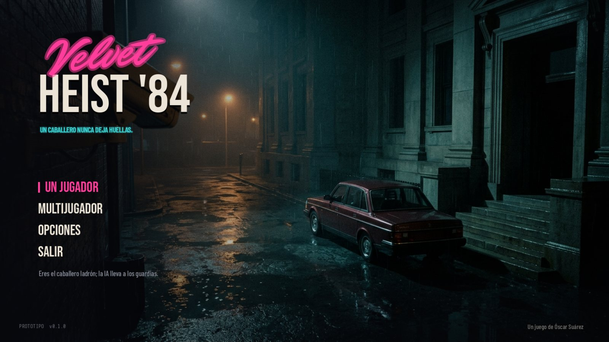
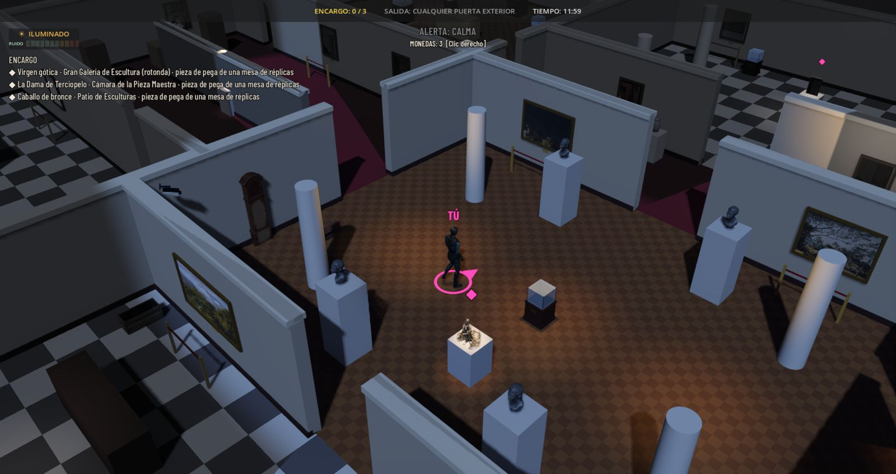
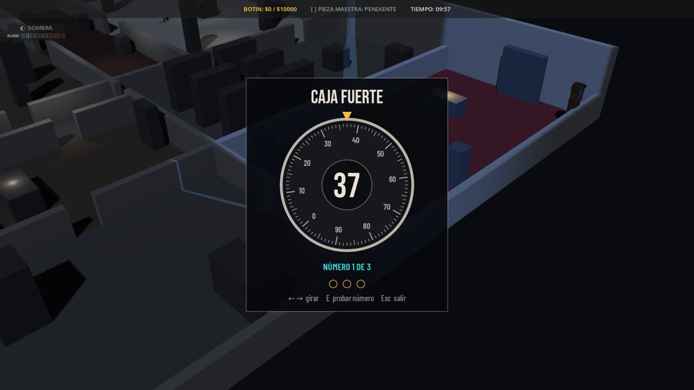

# Velvet Heist '84

**Un caballero nunca deja huellas.**

Sigilo táctico asimétrico multijugador en 1984. 
Un ladrón de guante blanco frente a una patrulla de guardias, en red o en solitario contra la IA.

&nbsp;

&nbsp;

**[⬇ Descargar la última versión](https://github.com/suarezoscar/velvet-heist-84/releases/latest)**

---

## El juego
Es de noche en el Museo Velvet. El **ladrón**, un caballero al estilo de Arsène Lupin que roba con guante blanco y jamás recurre a la violencia, trae el encargo de un coleccionista: varias piezas concretas entre las candidatas del museo. Tiene diez minutos para robarlas y salir por cualquier puerta exterior sin que lo atrapen. Los **guardias** han recibido su carta, *«Esta noche me llevaré tres piezas de su colección»*, pero no saben cuáles. Patrullan con linterna, fichan en los relojes de ronda y vigilan las cámaras desde la garita.

Nadie lo ve todo:
- **El sonido es información.** Cada paso sobre mármol, parqué o alfombra suena distinto, y cada interruptor, caja fuerte o reloj deja un rastro que el otro bando puede oír.
- **Información frente a número.** El ladrón ve más y oye más lejos; los guardias son más y se reparten el edificio.
- **Niebla de guerra.** Solo ves lo que tu personaje tiene a la vista. Lo demás queda en penumbra, como lo recuerdas.
- **El ladrón no es violento.** Se esconde, engaña y espera su momento; nunca ataca.
- **Tecnología de 1984.** Cámaras CCTV con monitores, relojes de fichar mecánicos y cajas fuertes de dial. Nada de drones ni de visión nocturna.

<table>
<tr>
<td width="50%"></td>
<td width="50%"></td>
</tr>
<tr>
<td><b>El ladrón.</b> Lo que no ve queda en penumbra, y a un guardia tras un muro solo se le delata la linterna.</td>
<td><b>Los guardias.</b> Salen de la garita, donde los monitores muestran lo que ven las cámaras del museo.</td>
</tr>
<tr>
<td></td>
<td valign="top">
<b>La caja fuerte.</b> Gira el dial con las flechas y prueba cada número con <kbd>E</kbd>. Cada intento suena, y fallar suena más: los guardias pueden oírte trabajar.
  
<b>La ronda.</b> Cada reloj de fichar debe marcarse antes de que se agote su tiempo. Si los guardias se dejan demasiados, la ronda se rompe y ya solo les vale atrapar al ladrón.
</td>
</tr>
</table>

## Cómo jugar
1. Descarga el paquete de tu sistema desde la **[última versión](https://github.com/suarezoscar/velvet-heist-84/releases/latest)**:
   - **Windows**: descomprime el `.zip` y abre `VelvetHeist84.exe`. El ejecutable no está firmado: en el aviso de SmartScreen pulsa «Más información» y luego «Ejecutar de todos modos».
   - **Linux**: `tar -xzf VelvetHeist84-*-linux.tar.gz` y después `./linux/VelvetHeist84.x86_64`.
2. Elige un modo:
   - **Un jugador**: eres el ladrón y la IA lleva a dos guardias.
   - **Multijugador**: escribe la IP del servidor, pulsa Unirse, elige bando y empezad. Al acabar, si todos pulsan **Revancha**, se juega otra con los mismos bandos sin salir del juego.

| Acción | Tecla |
|---|---|
| Moverse / mirar | <kbd>WASD</kbd> o flechas / ratón |
| Correr · sigilo · agacharse | <kbd>Mayús</kbd> · <kbd>C</kbd> · <kbd>Ctrl</kbd> |
| Interactuar · robar a lo bruto (salta la alarma) | <kbd>E</kbd> · <kbd>Q</kbd> |
| Plano del museo | <kbd>M</kbd> o <kbd>Tab</kbd> |
| Linterna · porra (guardias) | <kbd>F</kbd> · clic izquierdo |
| Panel de rendimiento y red | <kbd>F9</kbd> |
| Pausa: controles y salir | <kbd>Esc</kbd> |
| Revancha · volver al menú (al acabar) | <kbd>R</kbd> · <kbd>Esc</kbd> |

La lista completa está en el juego, en **Opciones → Ver controles**.

## Jugar en red
Un PC hace de **servidor dedicado**. Es el mismo ejecutable, sin ventana: `servidor.bat` en Windows o `./servidor.sh` en Linux, ambos incluidos en el paquete. Abre el puerto **UDP 7777** en el router y pasa tu IP pública a tus amigos. Caben un ladrón y hasta tres guardias, y para empezar hace falta el ladrón y al menos un guardia.

Todos deben usar la misma versión, que se ve abajo a la izquierda del menú; si no coincide, el lobby avisa de cuál necesitas. Con <kbd>F9</kbd> verás el ping y la pérdida de paquetes de cada jugador.

La guía completa, con el router, el cortafuegos, CGNAT y cómo compilar desde el código, está en **[docs/manual-compilacion.md](docs/manual-compilacion.md)**.

## Estado
Es un **prototipo** (v0.x): un mapa, el museo, y las mecánicas base de sigilo, sonido, luz, cámaras, relojes de ronda, caja fuerte y niebla de guerra. Cada cambio que se integra en `master` publica una versión nueva automáticamente.

## Para desarrollar
- Motor: **Godot 4.7.2** (Forward+), GDScript con tipado estático.
- Diseño del juego: [`docs/gdd/`](docs/gdd/), con los [pilares](docs/gdd/pillars.md) y un documento por sistema.
- Reglas del proyecto y flujo de trabajo: [`AGENTS.md`](AGENTS.md).
- Comprobaciones (las mismas que pasa el CI): `tools/ci/import.sh`, `check_scripts.sh`, `lint.sh`, `check_patterns.sh` y `run_tests.sh`.
- Compilar los paquetes: `tools/build/install_templates.sh` (una vez) y `tools/build/export.sh`.

---

Un juego de <b>Óscar Suárez</b> · Tipografías de Google Fonts con licencia <a href="assets/fonts/CREDITS.md">SIL OFL 1.1</a> 
Música: «Coffee Black» de grimfrenzy (CC-BY 3.0) y «Espionage» de haeldb (CC0) · Sonidos: Kenney (CC0), «Yawn» de spookymodem y «coffee cooking» de Christoph (CC-BY 3.0), en <a href="assets/audio/CREDITS.md">créditos de audio</a> · Cafetera: «Coffee Cart 01» de Joe Seabuhr (Poly Haven, CC0)

